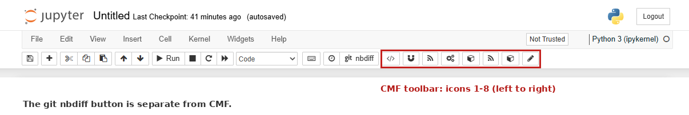
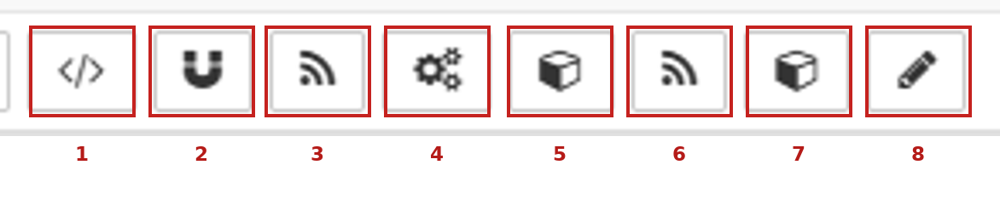

# CMF Jupyter Notebook Extension

## What this notebook provides

Jupyter Notebook lets you write and run Python code in small sections called
**cells**. The Common Metadata Framework (CMF) extension adds toolbar buttons
that help you record information about your work:

- **Pipeline stages and runs:** Add code to identify a stage, such as training,
  and record an execution of that stage.
- **Datasets:** Add code to track input and output data files.
- **Models:** Add code to record a saved model and information about it.
- **Metrics:** Add example code to record evaluation results.
- **Organized stage cells:** Add cells for inputs, processing, and outputs.
- **Optional integrations:** Select data sources from a separately configured
  service, or insert a Kafka forwarding template.

> **Important:** The buttons insert code templates. They do not complete or run
> that code for you. Review the inserted code and replace example values before
> running it. Data-source and Kafka integrations require additional setup by
> your administrator.

### Recognize the CMF buttons

The **red box** marks the CMF buttons. These buttons have icons rather than
text labels. Hold your mouse over a button to read its description.



The enlarged image numbers the buttons from left to right:



| Number | Icon | What it adds |
|---|---|---|
| 1 | Code `</>` | Pipeline-stage context and execution code. |
| 2 | Magnet | Input, processing, and output cells for a stage. |
| 3 | RSS/waves | A data-source selection form, if the service is configured. |
| 4 | Gears | Dataset logging calls based on file references in the selected cell. |
| 5 | Cube | An example metrics calculation and logging template. |
| 6 | RSS/waves | A dataset logging template to fill in manually. |
| 7 | Cube | A model logging template to fill in manually. |
| 8 | Pencil | A Kafka forwarding template that requires additional configuration. |

The **git nbdiff** button to the left of the red box is a separate notebook
comparison tool, not a CMF button.

## Install the notebook

These steps are for the person setting up the service on a Linux computer or
virtual machine (VM). A VM is the remote computer where the notebook will run.
If you are unfamiliar with terminal commands, ask your administrator to perform
this section.


### Step 1: Open the CMF project folder

In the terminal, change to the CMF project folder supplied by your administrator:

```bash
cd /path/to/cmf
```

Replace `/path/to/cmf` with the actual location. Do not type the example path
unchanged.

For example, the location on the demonstration VM is:

```bash
cd /home/user/cmf
```

Check that you are in the correct folder:

```bash
ls pyproject.toml jupyter-plugin-legacy/docker-compose.yml
```

Both names should be listed without a "No such file" error.
Run the remaining installation commands in this same terminal.

### Step 2: Configure the environment file

The CMF project includes an environment template named
[`env-example`](../env-example). Use it to prepare the settings for your machine.

If a `.env` file already exists in the CMF project folder, keep it and edit
only the required settings. **Do not overwrite existing configuration.**

If there is no `.env` file, create one:

```bash
cp env-example .env
chmod 600 .env
```

Open `.env` in your editor. For direct private VM access, add or update:

```dotenv
REACT_APP_CMF_API_URL=http://YOUR_VM_PRIVATE_IP:80
JUPYTER_BIND_IP=YOUR_VM_PRIVATE_IP
JUPYTER_TOKEN=PASTE_YOUR_GENERATED_TOKEN_HERE
GIT_USER_NAME=Your Name
GIT_USER_EMAIL=you@example.com
DVC_REMOTE_URL=/home/jovyan/dvc_remote
```

Replace `YOUR_VM_PRIVATE_IP` with the address your administrator provides.
For example, an address may look like `10.93.232.89`. Replace the name and email
with your own details.

The two address settings have different purposes:

| Setting | Purpose | Example |
|---|---|---|
| `REACT_APP_CMF_API_URL` | The React application's CMF API address; retain your existing Nginx port if it is not 80. This does not start or configure Jupyter. | `http://10.93.232.89:80` |
| `JUPYTER_BIND_IP` | The local VM interface on which Docker publishes Jupyter. Enter only the IP, without `http://` or a port. | `10.93.232.89` |

Use the direct VM address only if your administrator approves private-network
access. For localhost access or VS Code port forwarding, set
`JUPYTER_BIND_IP=127.0.0.1` instead.

Generate a login token in the terminal:

```bash
python3 -c 'import secrets; print(secrets.token_urlsafe(32))'
```

Copy the printed value into `.env`, replacing
`PASTE_YOUR_GENERATED_TOKEN_HERE`, then save the file. Do not leave the
placeholder unchanged. Keep this token private and do not commit `.env` or
include its contents in screenshots.

Create the storage folders:

```bash
mkdir -p "$HOME/workspace" "$HOME/dvc_remote"
```

The commands below explicitly load `.env` using `--env-file .env`. They do not
load `env-example` directly. Keep the token and bind-IP settings consistent if
you also have them exported in your terminal, because exported settings take
precedence over values in the environment file.

> Direct access using `http://` does not encrypt your token or notebook traffic.
> Use a trusted private network only. For other networks, ask for SSH forwarding
> or an HTTPS-protected notebook address. Do not expose this service publicly.

### Step 3: Build the notebook

Copy and run:

```bash
docker compose --env-file .env -f jupyter-plugin-legacy/docker-compose.yml build jupyter-cmf-notebook
```

The first build may take several minutes while software downloads. Wait for
the command to finish and return to the terminal prompt.

If the output includes `ERROR` or `failed to solve`, installation has not
completed. Save the error text without exposing credentials and ask your
administrator for help. Do not continue as if the build succeeded.

### Step 4: Start the notebook

```bash
docker compose --env-file .env -f jupyter-plugin-legacy/docker-compose.yml up -d --no-deps jupyter-cmf-notebook
```

This starts the notebook in the background so it remains available after the
command finishes. The CMF buttons are installed and enabled automatically.
The basic setup does not start the optional graph database or data-source
services.

Check the result:

```bash
docker compose --env-file .env -f jupyter-plugin-legacy/docker-compose.yml ps
```

Look for `jupyter-cmf-notebook_extension_test` with a status of **Up**.
The health status may initially say **starting**; allow about a minute for
startup checks. If it exits or remains unhealthy, ask your administrator to
inspect the service before proceeding.

### Step 5: Retrieve the login token

Run this in the VM or host terminal:

```bash
docker exec jupyter-cmf-notebook_extension_test printenv JUPYTER_TOKEN
```

Copy only the token printed by the command. Do not copy the command prompt.
You will paste the token into the login page next.

## Open the notebook and sign in

### If using localhost access

When `JUPYTER_BIND_IP=127.0.0.1`, use a browser on the same computer as
the notebook, or forward the port from your VM as described below.

Open:

<http://127.0.0.1:9999/tree>

### If the notebook runs on a VM and you use VS Code port forwarding

Use this method with `JUPYTER_BIND_IP=127.0.0.1`.

1. Connect VS Code to the VM using the connection your administrator provided.
2. Open **Terminal > New Terminal** if the bottom panel is not visible.
3. Select the **Ports** tab in that panel.
4. Click **Forward a Port** and enter **9999**.
5. Find the new port entry and choose **Open in Browser**.
6. Use the address VS Code opens. If local port 9999 is already occupied,
   VS Code may choose a different local port.

This connection lets your browser reach the VM without exposing the notebook
to everyone on the network.

### If your administrator enabled direct private VM access

Open the address they provide:

```text
http://YOUR_VM_PRIVATE_IP:9999/tree
```

For example, `http://10.93.232.89:9999/tree` works only when that VM has been
configured to accept connections on its private address and the network permits
your computer to reach it.

### Sign in

1. Find the field labelled **Password or token**.
2. Paste the token supplied by your administrator or retrieved in Step 5.
3. Click **Log in**.
4. You should see the notebook home page with a **New** button.

If an old browser session shows **Forbidden**, close the old notebook tabs,
clear site cookies for that notebook address, and sign in again. A private or
Incognito window is a quick way to check whether old browser cookies are the
cause. Do not disable authentication.

## Confirm the CMF buttons are available

1. On the notebook home page, choose **New > Python 3 (ipykernel)**.
2. Wait for the notebook editor to open.
3. If an **Authentication Key is required** message appears, dismiss it for
   this basic check. That message concerns the optional data-source service,
   not your notebook login.
4. Look for the eight icons shown in the red boxes above, to the right of
   **git nbdiff**.
5. Hold your mouse over each icon to see its description.

For a simple check that does not require running generated code:

1. Select an empty code cell.
2. Click **icon 6**, the second RSS/waves icon.
3. A dataset logging template should appear in that cell.

This confirms the extension is responding. Do not run that template unchanged:
its file path and input/output placeholders must first be filled in for your
actual work. Ask the person responsible for your pipeline for the correct
values.

> **Note:** The gears button (icon 4) searches existing code for dataset paths.
> It does not create a template in an empty cell. Use icon 6 for the simple
> check above.

## Return to the notebook later

If the service is still running, open the same website address and sign in.
Reconnect VS Code port forwarding if you use it.

If the notebook container has been stopped, its administrator can start it:

```bash
docker start jupyter-cmf-notebook_extension_test
```

To stop it when it is no longer needed, save all notebooks first, then run:

```bash
docker stop jupyter-cmf-notebook_extension_test
```

Stopping disconnects all users and ends running notebook computations.
Saved files in the configured workspace remain on the host.
